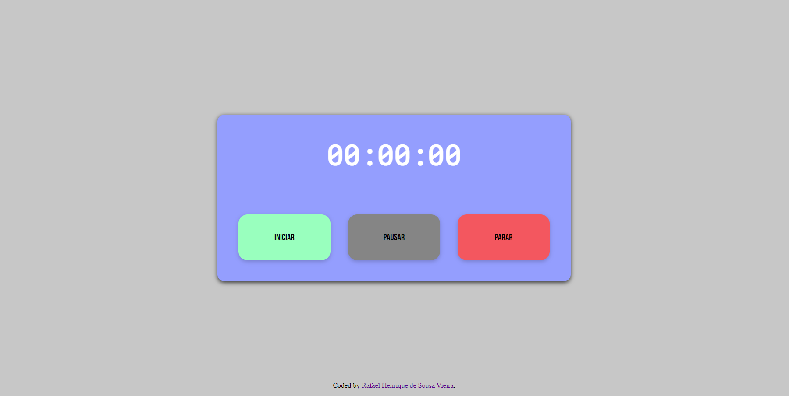

# Digital-Counter
This project aims to create a digital counter with html, css and javascript

## Table of contents

- [Overview](#overview)
  - [The challenge](#the-challenge)
  - [Screenshot](#screenshot)
  - [Links](#links)
- [My process](#my-process)
  - [Built with](#built-with)

## Overview

### Screenshot
  - Desktop
  
    
    
  - Mobile
  
    

### Links

- Live Site URL: https://digital-counter.netlify.app

## My process

### Built with

- Semantic HTML5 markup
- CSS custom properties
- Flexbox
- CSS Grid
- Mobile-first workflow
- Javascript

## Apoie

